# More Gestures

**Control Omarchy with Mouse and Trackpad Gestures.**

Opera-style mouse gestures for [Omarchy](https://omarchy.org): hold the right
button, draw a line, release. The same shapes work with three fingers on the
trackpad, four fingers are the system level, and a ring menu around the
pointer holds your workspaces, a move-window ring and any action you like. It
is set up the way [More Time](https://github.com/T-The-Coder/more-time) and
[More Weather](https://github.com/T-The-Coder/more-weather) are: the same
settings window, saved as you go, 30 languages and full keyboard control.

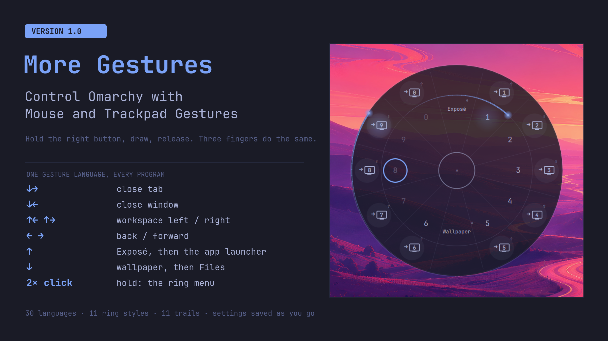

## Features

**Mouse**
- Hold the trigger (right button by default; middle, side or extra), draw,
  release. A short click stays a click; held still for 350 ms the press goes
  to the application, so dragging in a context menu works as before. With a
  modifier down nothing is intercepted: Super + right drag still resizes.
- Shapes of up to 5 strokes, a line under the pointer while you draw (eleven
  trail styles) and an indicator with the arrows so far and the action that
  releasing now would run.
- Trigger + wheel switches workspaces (in the browser: tabs). Rocker
  gestures (trigger, then left click, and the other way round) are opt-in.

**Trackpad**
- Three and four fingers: lines, shapes, pinch in and out. The trackpad is
  only read, never grabbed, so scrolling, tapping and Hyprland's own
  gestures keep working.
- Hyprland's workspace swipe follows the fingers, which no recogniser can
  do, so it stays native. It is a gesture in the list like the others,
  "← → swipe" with 3 or 4 fingers, whose effect is "Swipe workspaces
  (Hyprland)" or nothing (default: four fingers swipe).
- Four fingers up and down are layers; the opposite swipe undoes the last
  step:

  | Open now | 4 fingers down | 4 fingers up |
  |---|---|---|
  | nothing | wallpaper | Exposé |
  | Exposé | close Exposé | app launcher |
  | app launcher | close launcher | – |
  | wallpaper | Files (floating, centred) | windows back |
  | wallpaper + Files | – | close Files |

- Pinch in opens the app launcher, pinch out Hyprexpo, a four-finger double
  tap the ring menu.
- Corner taps (experimental, opt-in): double or triple tap a corner, by
  default workspaces 1-4 and 5-8. For this the touchpad is grabbed and
  forwarded; only touches in a bound corner are held back for a moment, so a
  single tap there still clicks, a little later.

**One gesture language.** The mouse and three fingers share every shape, and a
shape does the same in every program:

| Shape | Action |
|---|---|
| ← / → | back / forward (Alt+Left / Alt+Right) |
| ↑ | layer up: Exposé, then app launcher; closes Files / brings the windows back |
| ↓ | layer down: wallpaper, then Files; closes launcher / Exposé |
| ↑← / ↑→ | workspace left / right |
| ↓→ | close tab (Ctrl+W; in a terminal Ctrl+Shift+W) |
| ↓← | close window (Super+W) |
| ↓←↑ / ↓→↑ | move the window to the workspace left / right |
| ↓↑ | new tab (Ctrl+T) |
| ←↑ | reopen closed tab (Ctrl+Shift+T) |
| ↑↓ | reload (F5) |
| →↑ | toggle fullscreen |
| wheel | workspace left / right (browser: previous / next tab) |
| rocker left / right | back / forward |
| double click, hold | ring menu |

Everything can be changed. Gestures belong to a profile (Desktop, Browser,
Terminal, chosen by Omarchy's window tags); a profile only lists what differs.
New gestures are built from arrows or **recorded**: press Record and make the
gesture with the mouse, the trackpad or a corner tap. An action is a desktop
action, a key combination (recorded or typed, up to four steps), a command,
or nothing.

**Ring menu**
- Double click the trigger and keep the second press held (opt-in, since the
  first click then waits for the double click time), double tap with four
  fingers, or press **Super+Alt+R**.
- Ring 1 is a clock face: Exposé at 12, workspaces 1-5 at 1-5, the wallpaper
  at 6, workspaces 6-0 at 7-11. Move towards a slot and release, or let go in
  the middle and click one. Workspaces 6-0 are faded while empty, the current
  one is outlined.
- Ring 2 (on by switch) moves the window under the pointer to a workspace
  without following it: every slot sits straight outside its workspace and
  shows an arrow into a small monitor. Ring 3 holds window and program
  actions: close, fullscreen, floating, window left / right, scratchpad,
  terminal, Files, launcher, Hyprexpo.
- 8, 12, 16 or 24 slots per ring, any action in any slot. Rings too big for
  the screen are drawn smaller; outer rings show short names, the full name
  of the slot under the pointer appears in the middle.
- Picking a workspace shows its windows: it closes Exposé and brings back
  what the wallpaper layer hid, also on the workspace already shown.
  Super+1 … Super+0 do the same (on by default).

**Styles.** Each with a live preview, the ring under Ring menu › Style, the
trail under Mouse › Trail. With animations off every style is a still frame.

| Style | Ring | Trail |
|---|---|---|
| Plain | the slots and soft dividing lines | the accent line |
| Comets | a bright dot with a tail runs round every circle | a comet whose tail burns out |
| Drifting clouds | soft blobs drift behind the slots | a vapour trail that widens into puffs |
| Radar | a beam sweeps round, slots light up and fade | blips that fade one by one |
| Orbits | planets circle on the circles; twinkling stars | a thin line throwing stardust |
| Ink in water | the colour seeps out from the centre | a brush stroke, thick to thin |
| Neon | tubes flicker on one after the other | a glowing tube with a faint buzz |
| Pulse | rings of light run outwards | pulses run along the line |
| Clockwork | turning rows of ticks and a second hand | dashes with a mark at every turn |
| Aurora | a wavy band of colour flows along the circles | a ribbon whose colour runs along it |
| Fireflies | points of light swarm around the slot under the pointer | sparks that fall and go out |

**Settings and bar**
- Pages General, Mouse, Trackpad, Ring menu and What's new; every change is
  saved and applied at once.
- Language: Automatic or one of 30 (English, Deutsch, Español, Français,
  Português, Italiano, Nederlands, Polski, Русский, Українська, Türkçe,
  Čeština, Svenska, Suomi, Norsk bokmål, Dansk, Română, Magyar, Ελληνικά,
  हिन्दी, Bahasa Indonesia, Tiếng Việt, ไทย, 日本語, 한국어, 简体中文,
  繁體中文, العربية, עברית, فارسی).
- Export and import of all settings, with a backup before every import.
- A menu bar icon (the mouse symbol, faded while gestures are off) whose
  left, middle and right click you choose: settings, gestures on/off, a status
  notification, the ring, or nothing. An app launcher entry whose icon follows
  the theme.
- Nothing runs while the screen is locked: every action first asks Hyprland
  whether a session lock is held (any locker), and while it is the mouse and
  trackpad pass straight through.
- The settings' text and number fields read the clipboard only when you
  paste into them, not on every clipboard change (Qt 6.11 and 6.12.0 do that
  for ordinary text fields, even in a hidden window).
  Pasting (Ctrl+V, Shift+Insert or the middle button) reads at most 4 KiB
  within one second, through wl-paste (wl-clipboard).
- Exclusions: window classes or tags where the mouse passes untouched
  (default: Steam games, RetroArch, QEMU, virt-manager, gamescope).

## Screenshots

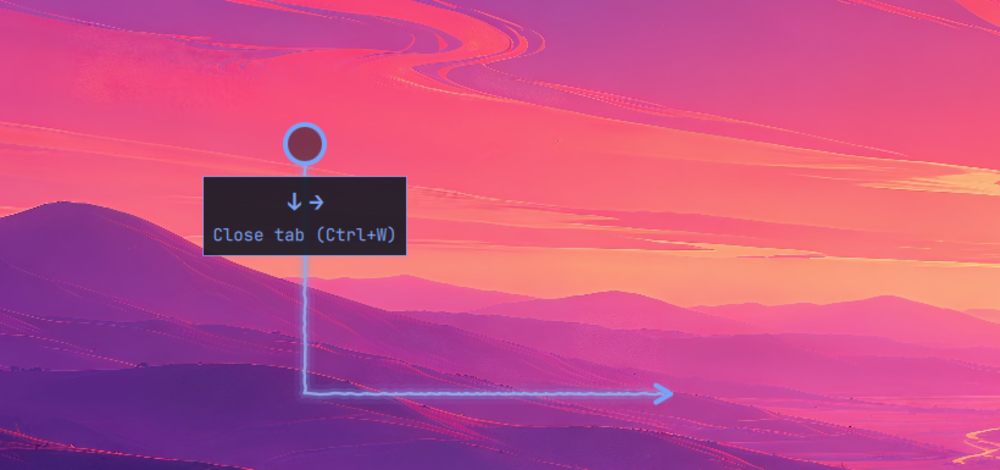

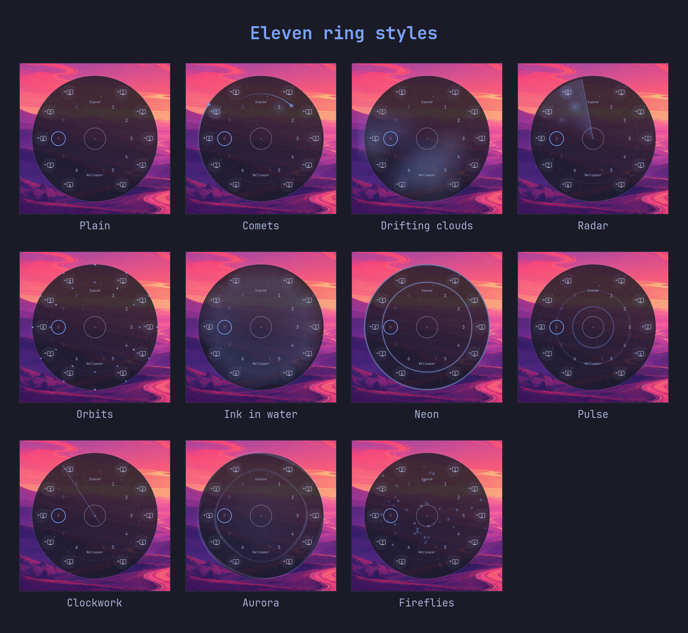

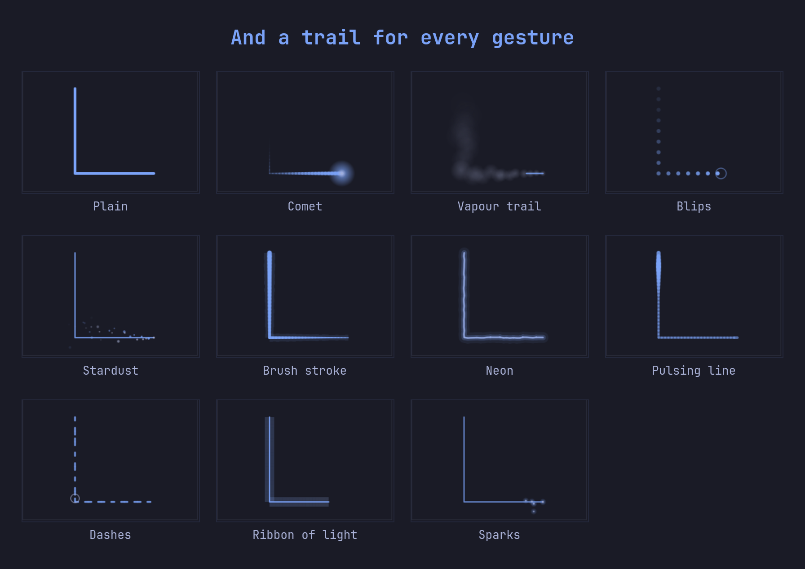

| | |
|---|---|
| 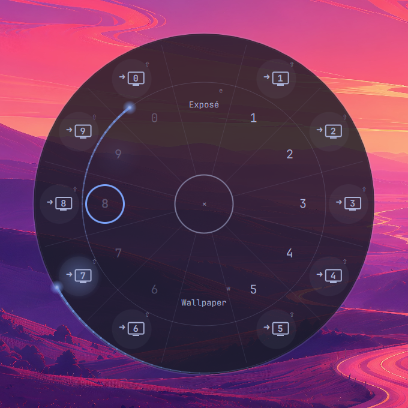 | 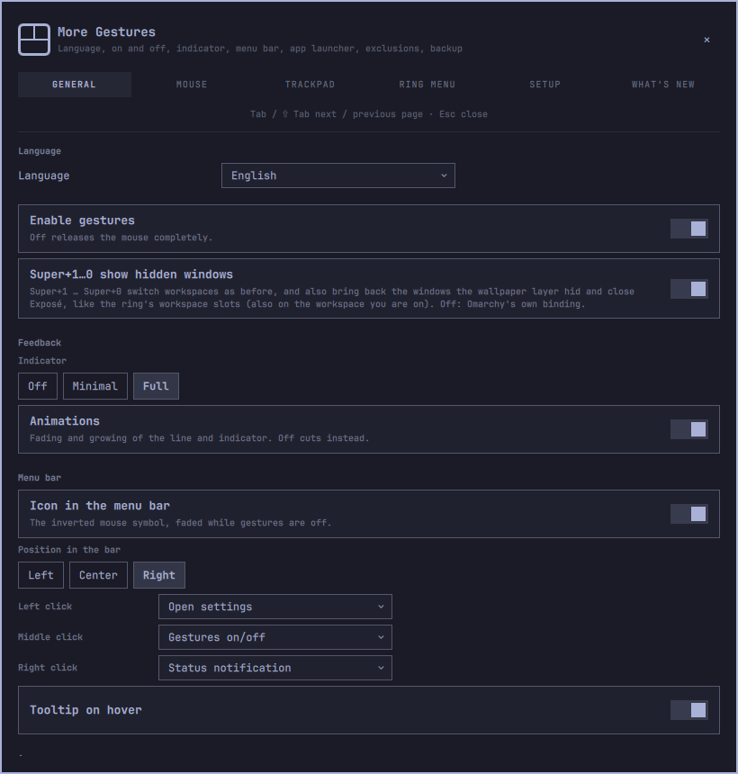 |
| 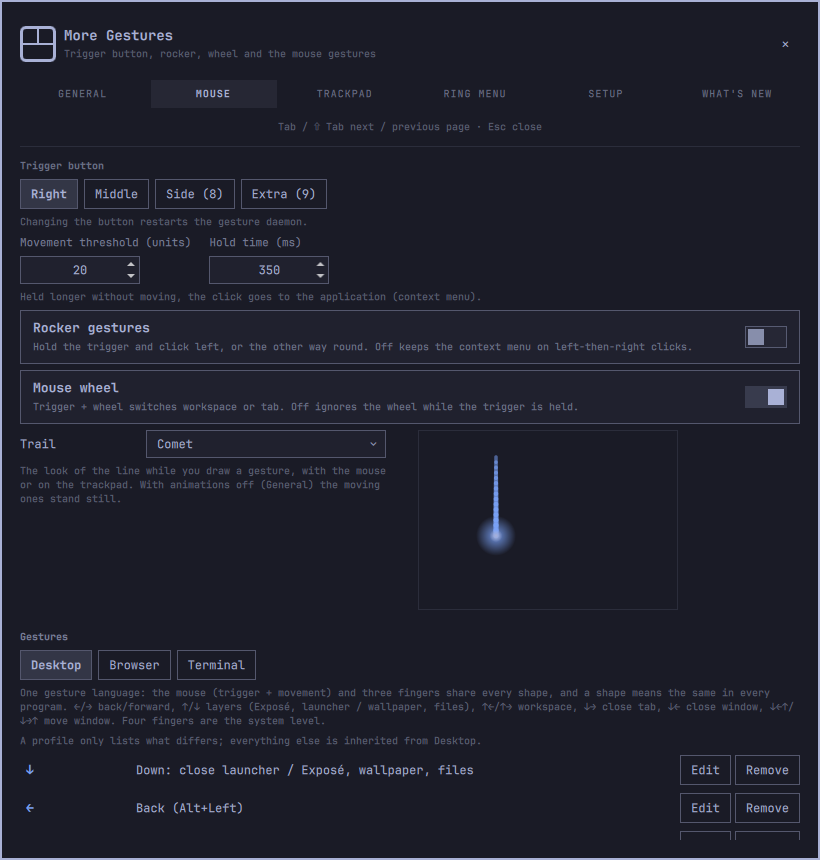 | 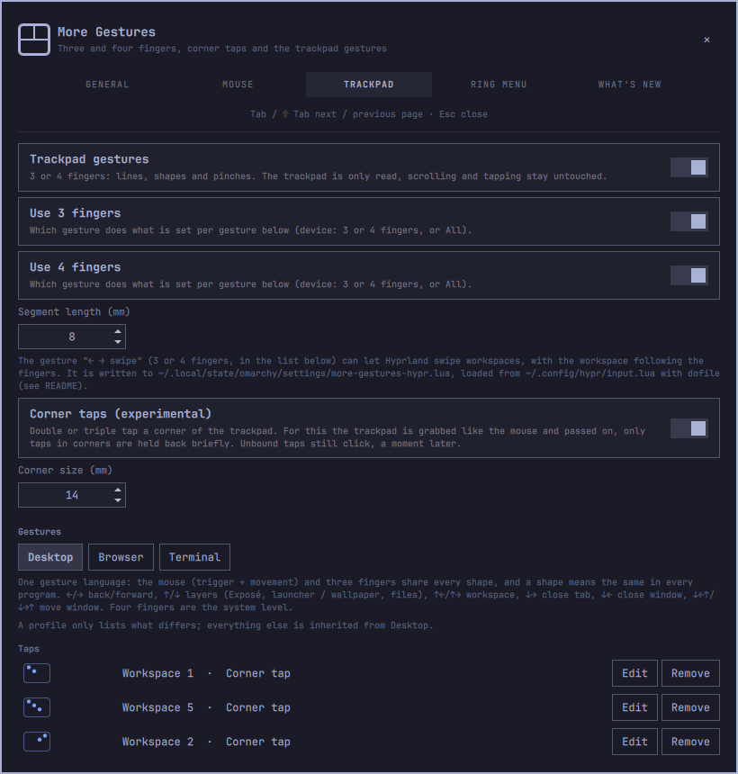 |
| 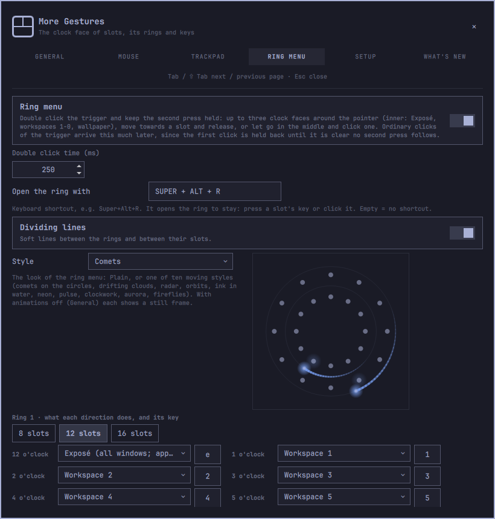 | 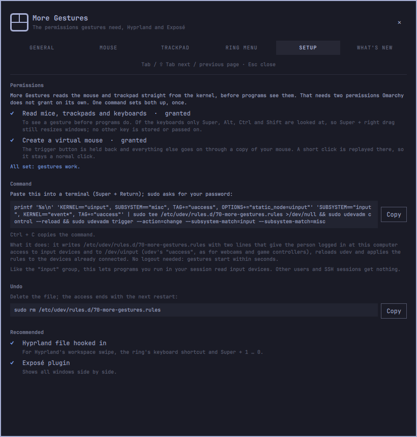 |
| 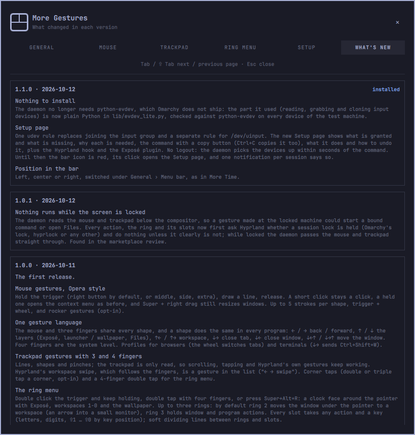 | |

## Keyboard

**Settings:** `Tab` / `Shift+Tab` next / previous page, `PageUp` / `PageDown`
and the arrows scroll, `Esc` closes.

**Ring menu:** `Esc` closes. Every slot can have a key, shown in its corner:
a letter, a digit, an upper-case letter (Shift+letter) or ⇧1 … ⇧0
(Shift+digit, matched by key position, so it works on every layout; type
`S1` or `⇧1` in the settings). Defaults: `1`-`0` workspaces, `e` Exposé, `w`
wallpaper; ring 2 `⇧1`-`⇧0`; ring 3 `q f s a d n t o l x`. A key used twice
keeps its first slot.

**Hyprland:** `Super+Alt+R` opens the ring (change or clear it under Ring menu);
`Super+1` … `Super+0` switch workspaces and show their hidden windows (switch
under General).

## Requirements

- Omarchy with Hyprland 0.56 or newer (Lua configuration) and its Quickshell
  shell.
- Python 3 (Omarchy ships it). Nothing else to install: the daemon talks to
  the kernel's input devices in plain Python.
- A one-time setup with one command (below), because Omarchy does not let a
  user read input devices or create a virtual one on its own.
- Recommended: the [Exposé plugin](https://github.com/kristofferR/omarchy-expose)
  for the "Exposé" action, the ring's 12 o'clock slot and the up layer.
  Without it they open the app launcher; the settings show the install
  command while it is missing:

  ```bash
  omarchy plugin add https://github.com/kristofferR/omarchy-expose.git --enable
  ```

- Optional: the Hyprexpo plugin (hyprpm) for 4-finger pinch out; without it
  that gesture opens Exposé, else the launcher.
- Everything else it calls ships with Omarchy: `hyprctl`, `omarchy-shell`,
  `omarchy-menu`, `omarchy-launch-terminal`, Nautilus for Files and `wl-copy`.
  Commands you bind to a gesture yourself run through `bash`.

## Installation

```bash
omarchy plugin add https://github.com/T-The-Coder/more-gestures.git --enable
```

The icon goes into the right section of the bar (move it under General ›
Menu bar › Position in the bar).

**One-time setup.** Until it is done the bar icon is red, a notification says
so and the settings open on their **Setup** page, which shows what is missing,
why, and the command with a copy button (`Ctrl+C` copies it there too). Paste
it into a terminal; `sudo` asks for your password:

```bash
printf '%s\n' 'KERNEL=="uinput", SUBSYSTEM=="misc", TAG+="uaccess", OPTIONS+="static_node=uinput"' 'SUBSYSTEM=="input", KERNEL=="event*", TAG+="uaccess"' | sudo tee /etc/udev/rules.d/70-more-gestures.rules >/dev/null && sudo udevadm control --reload && sudo udevadm trigger --action=change --subsystem-match=input --subsystem-match=misc
```

Why both are needed:

- **Read mice, trackpads and keyboards** (`/dev/input/event*`): to see a
  gesture before programs do. Of the keyboards only Super, Alt, Ctrl and Shift
  are looked at (so Super + right drag still resizes windows); no other key is
  stored or passed on.
- **Create a virtual mouse** (`/dev/uinput`): the trigger button is held back
  and everything else goes on through a copy of your mouse; a short click is
  replayed there, so it stays a normal click.

What it does: it writes `/etc/udev/rules.d/70-more-gestures.rules` with two lines that tag
both for udev's `uaccess` (as systemd does for webcams and game controllers),
so the person logged in at this computer gets access; other users and SSH
sessions get nothing. It then reloads udev and applies the rules to the devices
already connected: no logout, gestures start within seconds. Like membership
in the `input` group, it lets programs you run in your session read input
devices. To undo it, delete the file (the access ends with the next restart):

```bash
sudo rm /etc/udev/rules.d/70-more-gestures.rules
```

**Hyprland hook.** Hyprland's workspace swipe, the ring's shortcut and
Super+1…0 live in a file the plugin writes,
`~/.local/state/omarchy/settings/more-gestures-hypr.lua`. Hyprland loads it
once `~/.config/hypr/input.lua` does. The settings say so while it is
missing; **Set up** adds a marked block to `input.lua` (after a backup next to
it) and reloads Hyprland. The same from a terminal:

```bash
~/.config/omarchy/plugins/more-gestures/bin/hypr-hook           # add the block
~/.config/omarchy/plugins/more-gestures/bin/hypr-hook --check   # exit 0 if loaded
```

The block only loads the file if it exists, so removing the plugin breaks
nothing. If you had `hl.gesture` lines of your own for the finger counts the
plugin reads, remove them, or both act.

## Updating

```bash
omarchy plugin update more-gestures
```

See [CHANGELOG.md](CHANGELOG.md); Settings › What's new shows it in the app,
read from the installed plugin. Your settings stay as they are.

## Removal

1. If you added the launcher entry, turn **Show in app launcher** off first
   (or run `bin/launcher-entry --remove`).
2. Take the Hyprland hook out again (a backup of `input.lua` is made first):

   ```bash
   ~/.config/omarchy/plugins/more-gestures/bin/hypr-hook --remove
   ```

3. Optional: remove the udev rule from the one-time setup (the access ends
   with the next restart):

   ```bash
   sudo rm /etc/udev/rules.d/70-more-gestures.rules
   ```

4. Remove the plugin:

   ```bash
   omarchy plugin remove more-gestures
   ```

5. Optional: delete the settings and the generated Hyprland file:

   ```bash
   rm -f ~/.local/state/omarchy/settings/more-gestures*.json \
         ~/.local/state/omarchy/settings/more-gestures-hypr.lua
   ```

## Files

| Path | What |
|---|---|
| `~/.local/state/omarchy/settings/more-gestures.json` | all settings (written by the settings window, watched by the service) |
| `~/.local/state/omarchy/settings/more-gestures-hypr.lua` | generated for Hyprland: swipe gestures, ring shortcut, Super+1…0 |
| `~/.local/state/omarchy/settings/more-gestures-settings-backup.json` | the settings before the last import |
| `~/Downloads/more-gestures-settings.json` | default export file |
| `~/.config/hypr/input.lua` | gets the marked block from **Set up** |
| `/etc/udev/rules.d/70-more-gestures.rules` | the one-time setup (written by you with `sudo`, see Installation) |
| `$XDG_RUNTIME_DIR/more-gestures-recorded.json` | the gesture handed to the editor while recording |

## IPC

```bash
omarchy-shell -q more-gestures <function>
```

| Function | Does |
|---|---|
| `settings` | opens the settings window |
| `openRing` | opens the ring menu at the pointer, to stay |
| `toggleSaved` | gestures on / off, saved |
| `enable` / `disable` / `toggle` | gestures on / off until the shell restarts |
| `notifyStatus` | a notification with the current state |
| `status` | JSON: daemon state and restarts, active window and profiles, last gesture and action |
| `recordGesture` / `stopRecording` | hand the next gesture to the editor instead of running it |

## Development

```bash
python -m unittest discover -s tests
node --test tests/*.test.mjs
tests/qml-syntax.sh                 # every QML file parses (qmllint)
tools/build-preview.sh <shots-dir>  # screenshots/ and preview.png from raw shots
```

**Daemon.** `bin/gesture-daemon` is a thin evdev/uinput frame
(`lib/evdev_lite.py`: the part of python-evdev it needs, in plain Python with
ioctl and struct, so nothing has to be installed) around
`lib/gesture_core.py` (state machine, direction recogniser, commands),
`lib/touchpad_core.py` (fingers, millimetres, pinches) and `lib/tap_core.py`
(corner taps), which know nothing of evdev and are tested with recorded
event sequences. It grabs pointing devices (`REL_X`/`REL_Y` and the trigger,
no `ABS_MT`), forwards everything through a uinput clone and holds only the
trigger press back; touchpads are read without a grab. It lives as a child of
the shell, with stdin as its leash: SIGTERM, SIGINT and EOF release the grab,
and if it dies any other way the kernel does. A gesture held longer than 10 s
is reset. `bin/gesture-daemon --dry-run` grabs nothing and prints devices and
state changes; `--check` prints what this user may access (the Setup page and
the bar icon use it). Devices it may not open or clone yet are tried again on
every scan (every 2 s), so it starts working right after the setup command.

**Protocol.** stdout, one JSON object per line: `start`, `segment {dirs}`,
`progress {dir, ratio}` (≤ 30 Hz), `end {gesture}`, `cancel`, `wheel {dir}`,
`rocker {side}`, each with `source` (`mouse`, `touchpad` with `fingers`, `tap`).
stdin: `pass on|off` (forward everything untouched, for excluded windows) and
`config {json}` (threshold, hold time, rocker, trackpad and tap settings).

**Plugin.** `Service.qml` runs the daemon, tracks the active window, resolves
gestures with `Actions.js` and runs the result; `Settings.qml` is the
settings overlay, `GestureOverlay.qml` the line and indicator,
`RingOverlay.qml` the ring with `Ring.js` (geometry) and `Effects.js` (the
styles, pure functions of time and geometry, tested with a recording canvas),
`BarWidget.qml` the bar icon. `Config.js` is the settings contract and writes
the Hyprland file. Actions become Lua for `hyprctl eval` only from fixed
strings and validated parts (modifiers from an allow-list, keys against
`^[A-Za-z0-9_]{1,32}$`), so a hand-edited settings file cannot inject Lua.

**Languages.** The texts of the 30 languages live in `i18n/<language>.js`,
one file each; English is the base and every other file an overlay on it.
`I18n.js` imports them and holds the lookup; action names in other languages
than English and German are `act_<id>` / `label_<label>` entries there.
`tests/i18n.test.mjs` checks that every language has every key with the same
placeholders, `tests/load.mjs` resolves the imports for Node.

`Changelog.js` (Settings › What's new) is shared with More Time and More
Weather and kept identical (`tests/changelog.test.mjs`).

## License

MIT, see [LICENSE](LICENSE).
